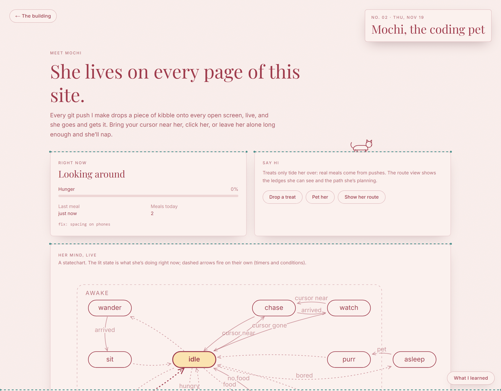
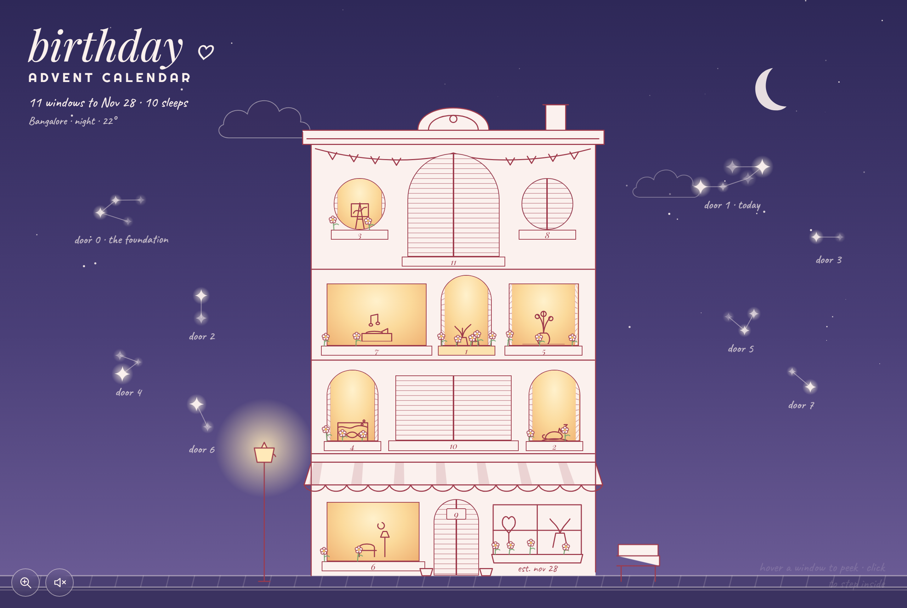
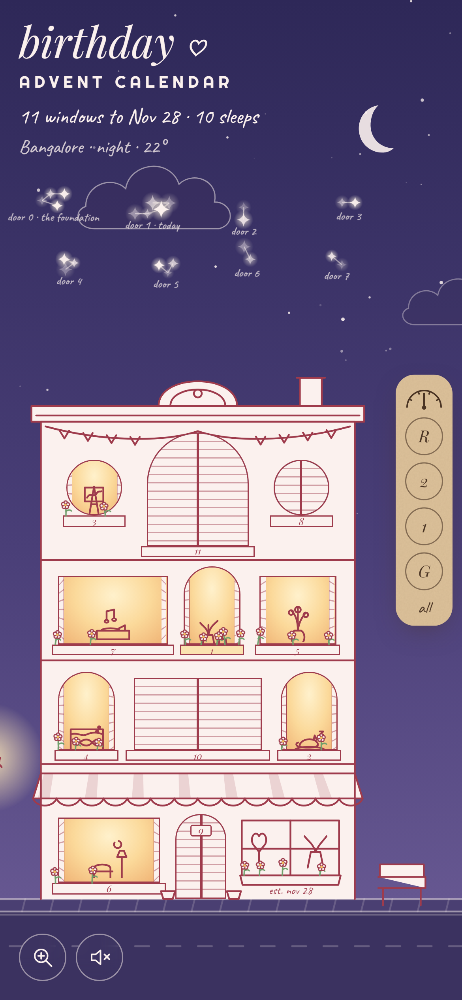

<div align="center">

# birthday ♡ advent calendar

### A tiny illustrated building that counts down to my birthday, one window a day.
Peek inside the windows, pet the cat, and paint a record from **your** birthday.

<br/>

[**✨ Open the building →**](https://advent-birthday-hng9.vercel.app)
&nbsp;&nbsp;·&nbsp;&nbsp;
[**🎵 Paint your birthday records →**](https://advent-birthday-hng9.vercel.app/door/3)
&nbsp;&nbsp;·&nbsp;&nbsp;
[**🐈 Meet Mochi →**](https://advent-birthday-hng9.vercel.app/door/2)

<br/>


[](https://advent-birthday-hng9.vercel.app)


</div>

[](https://advent-birthday-hng9.vercel.app)

## Try it: six things to do in two minutes

1. **[Peek in a window.](https://advent-birthday-hng9.vercel.app)** Hover (or tap) one: the shutters swing open on
   a tiny room. Click an open one and the camera **flies through it** into
   that day's build. Future windows rattle but won't open. No peeking.
2. **Find the cat.** Mochi wanders every page. Bring your cursor near her
   and she'll chase it; **click her** and she purrs; ignore her long enough
   and she curls up for a nap.
3. **[Watch her think.](https://advent-birthday-hng9.vercel.app/door/2)** On her page, her brain is drawn live
   and lights up as she changes mood. Press **Show her route** to see the
   ledges she can climb and the path she's planning.
4. **[Paint a record from your birthday.](https://advent-birthday-hng9.vercel.app/door/3)** Enter your birthday
   and the whole crate repaints: one unique record per song, made from your
   date. Switch between *Dreamy*, *Meadow* and *Painted vinyl*, then
   **download yours** or send the link to a friend: it opens your exact crate.
5. **Put a record on.** Pull one out of the crate, drop it on the turntable,
   and it plays (through Spotify) while the tonearm follows the song.
6. **Come back tonight.** The sky is Bangalore's real sky right now: at
   night the lamps come on in every window I've worked in, and when it rains
   in Bangalore, it rains on the building. A new door opens every midnight
   (India time) until **Nov 28**, when the whole building lights up.

> **It's alive while you watch.** Every `git push` I make lights a window,
> plants a flower in its window box, adds a star to the sky and drops a piece
> of kibble for Mochi, live, on every open screen. Leave it open in a tab.

## What you're looking at

- **Each window is a door**, and each door is a small build I made that day.
- **Future windows stay shuttered.** The server decides what's open in India
  time, so changing your clock doesn't help, and sealed pages never send their
  content to the browser.
- **The building is made of my commits.** Every push plants a fine-line flower
  in that day's **window box** and adds a **star** to that day's
  **constellation**.
- **A cat lives here.** Mochi roams every page, climbing the planters,
  awning and cornice (door 2).
- **The sky is real:** Bangalore's sky right now (dawn, day, dusk, night,
  rain), from the Open-Meteo weather API.

## Door 1 · The living garden


**[▶ Visit the greenhouse](https://advent-birthday-hng9.vercel.app/door/1)** · hover a flower to see the commit that grew it.

A glass greenhouse under the night sky. **Inside**, one pot per door: every push
grows a new stem in its day's pot, so busy days become bushy plants. **Outside**,
the same push is a star in that day's constellation.

- **Each flower is tinted by the tech stacks the push touched.** The webhook
  sorts every changed file (TypeScript, CSS, SQL, Markdown, Java…), and the
  petals split between those colours in proportion.
- **Five species** (cosmos, tulip, bellflower, lavender, rose), chosen by the
  commit's SHA, so a commit always grows the same flower.
- **No overlaps, by construction:** every plant stays inside its pot's column
  and is height-capped under the curve of the glass.

## Door 2 · Mochi, the coding pet



**[▶ Meet Mochi](https://advent-birthday-hng9.vercel.app/door/2)** · pet her, drop her a treat, show her route.

Mochi is a fine-line cat who lives on **every page** of the site. She wanders,
grooms, naps, chases your cursor and climbs the building: the planters,
the awning, the cornice and the bench are all ledges she can jump between.
**Every `git push` drops a piece of kibble** onto every open screen, live, and
she works out how to get to it.

- **A statechart brain** (XState): idle, wander, sit, groom, chase, watch,
  hungry, toFood, eating, purr, asleep. It only decides *what* she wants;
  delays and randomness are injectable, so every behaviour has a unit test.
- **The page is her level.** Elements marked `data-mochi-platform` become
  one-way ledges, measured live while the camera zooms and scrolls. **A\***
  over (ledge, x) states finds the cheapest mix of walks and jumps.
- **Real jumps.** Each one is a projectile arc solved through an apex above
  the higher ledge: y = y₀ + v₀t + ½gt².
- **Hunger from the push log**, not a timer: it's the time since the last
  push, so every device agrees on how hungry she is.
- **Her home page** (door 2) shows her mind live: the statechart lights up as
  she changes state, and "Show her route" draws the ledges she can see and
  the path she's planning.

## Door 3 · Birthday records


**[▶ Paint your birthday records](https://advent-birthday-hng9.vercel.app/door/3)** · enter your birthday, pick a song, download your record.

A crate of eight songs, and every song gets **its own record, painted by my
birthday**. Pull one out, it drops onto the turntable, spins up, and plays
through Spotify while the tonearm rides the record with the song's progress.

- **Birthday × song.** Each record's seed is the birthday (month and day
  only) mixed with the song's Spotify ID: every song looks different, and the
  same birthday always paints the same crate.
- **Plan, then paint.** A seeded `plan()` turns the seed into pure brush
  instructions (unit-tested: deterministic, on the disc, evenly spaced
  flowers via Poisson-disc sampling); `render()` paints them. Watercolour is
  dozens of nearly transparent layers of a recursively deformed polygon.
- **Three themes** over the same seed: *Dreamy* (swirls, dotted rings,
  glitter), *Meadow* (vines and inked flowers) and *Painted vinyl* (black
  vinyl, painted band, printed label).
- **A turntable with weight.** The platter eases up to 33⅓ rpm and coasts
  down; the sheen stays still while the record turns under it.
- **Make yours.** Enter any birthday to repaint the whole crate; theme and
  birthday live in the URL, so a crate can be shared exactly. Download any
  record as a 3000 px PNG.

<table>
<tr>
<td width="50%"></td>
<td width="50%"></td>
</tr>
<tr>
<td align="center"><sub><b>Night:</b> lamps glow in every window I've worked in</sub></td>
<td align="center"><sub><b>Nov 28:</b> every window lights up, the cake appears, fireworks</sub></td>
</tr>
</table>

<table>
<tr>
<td width="62%"></td>
<td width="38%"></td>
</tr>
<tr>
<td align="center"><sub><b>🔍 Zoom</b> for bigger windows and text (↑/↓ to change floors)</sub></td>
<td align="center"><sub><b>Phones:</b> a brass elevator rides between floors</sub></td>
</tr>
</table>

## The 11 doors

One build a day, about 2 hours each, each one something I wanted to learn. A new door opens every midnight, India time.

| # | Date | Build | Learning | Status |
|---|---|---|---|---|
| 0 | Tue 17 | [The foundation](https://advent-birthday-hng9.vercel.app) | the building, webhook, unlock rules | ✅ shipped |
| 1 | Wed 18 | [The living garden](https://advent-birthday-hng9.vercel.app/door/1) | Realtime, seeded generative art, SVG | ✅ shipped |
| 2 | Thu 19 | [Mochi, the coding pet](https://advent-birthday-hng9.vercel.app/door/2) | statecharts, A* pathfinding, projectile physics | ✅ shipped |
| 3 | Fri 20 | [Birthday records](https://advent-birthday-hng9.vercel.app/door/3) | seeded generative painting, Spotify iFrame API | ✅ shipped |
| 4 | Sat 21 | GPU koi pond | spatial hashing, WebGPU | 🔒 |
| 5 | Sun 22 | Recursive flowers | L-systems, Rust → WASM | 🔒 |
| 6 | Mon 23 | Cozy room, real sky | caching, edge functions | 🔒 |
| 7 | Tue 24 | Firefly music | embeddings, clustering | 🔒 |
| 8 | Wed 25 | Holographic card | sensor APIs, OG images | 🔒 |
| 9 | Thu 26 | Time-locked letter | applied cryptography | 🔒 |
| 10 | Fri 27 | Jae: The Game | ECS, deterministic replays | 🔒 |
| 11 | Sat 28 🎂 | Blow out the candles | signal processing | 🔒 |

## How a push becomes a flower and a star


1. **GitHub** sends a signed `push` event to `/api/github/webhook`.
2. The route **verifies the HMAC-SHA256 signature** over the raw body, compared
   in constant time. Unsigned or forged requests get `401`.
3. It sorts the changed files by tech stack and calls **`record_push()`**: one
   Postgres transaction that records the push (deduplicated on GitHub's
   delivery ID), lights today's window, and ships any door tagged `door:N`.
4. **Supabase Realtime** streams the new rows over a websocket, and every open
   page grows the flower and star in about a second, and drops a piece of
   kibble that Mochi goes and eats.

## Under the hood

A few things that were fun to figure out:

- **Idempotent, atomic webhook.** GitHub retries deliveries, so the delivery ID
  is a unique key (a retry is a no-op), and everything happens in one
  transaction, so a crash can't half-record a push.
- **The server owns the clock.** Doors unlock by India time on the server.
  The client only renders what it's told, so you can't peek by changing your
  clock.
- **Deterministic generative art.** Flowers, star positions and constellation
  shapes are seeded from the commit SHA with integer-only hashing (`Math.imul`),
  so every device draws the exact same garden.
- **A hydration bug from `Math.cos`.** Node and browsers can disagree on the
  last digit of trig results, so server-rendered SVG coordinates didn't match
  the client's. The fix: round coordinates, and use precomputed direction
  tables instead of trig.
- **Resilient deploys.** The webhook and queries detect a database that hasn't
  had the latest migration yet and fall back instead of failing, so code and
  schema can ship in either order.
- **Brain and body, kept apart.** Mochi's statechart only decides what she
  wants; the animation loop decides how to get there. So her behaviour is
  pure logic with unit tests, and the A\* planner and jump physics are pure
  functions with tests of their own.
- **Accessibility.** Every window is a real button with a spoken label, there's
  a zoom mode and keyboard navigation, and all motion respects
  `prefers-reduced-motion`.

## Built with

| | |
|---|---|
| **Frontend** | Next.js 16 (App Router) · React 19 · TypeScript · Tailwind CSS 4 · Framer Motion · hand-drawn SVG |
| **Mochi** | XState 5 statechart · A\* pathfinding · projectile physics · `requestAnimationFrame` loop |
| **Backend** | Next.js route handlers · Supabase (Postgres, Row Level Security, Realtime) |
| **Data** | GitHub push webhooks · Open-Meteo weather API · Spotify embed (iFrame API) |
| **Hosting** | Vercel (auto-deploys on every push to `main`) |
| **Tooling** | pnpm workspaces · `node:test` unit tests · headless-Chrome screenshot script |

```
apps/web/                 the Next.js site
  app/page.tsx            the building (server: unlock rules, sky, pushes)
  app/door/[n]/           one page per door, sealed until its date
  app/api/github/webhook/ signed GitHub push → record_push()
  components/building/    façade, windows, window boxes, constellations, elevator
  components/mochi/       Mochi's drawing, runtime loop, live statechart diagram
  lib/mochi/              her statechart and world model (A*, jump arcs), with tests
  lib/records/            door 3's seeded record painter and the song list
  components/records/     record disc, turntable, crate, Spotify player hook
  lib/                    unlock rules (IST), sky, constellations, file kinds
packages/garden-ui/       shared design tokens, motion presets, DoorFrame
supabase/migrations/      schema, row-level security, seed, record_push()
```

## Run it yourself

The full guide covers running it locally with preview modes, then Supabase,
Vercel and the GitHub webhook, plus troubleshooting:
**[docs/SETUP.md](docs/SETUP.md)**.

```bash
pnpm install
cp apps/web/.env.example apps/web/.env.local   # set DEV_UNLOCK_ALL=true
pnpm dev                                       # http://localhost:3000/?preview=mixed
pnpm --filter web test                         # unit tests (Mochi, route planner, record painter)
```

---

<div align="center">

**Made a crate you love? Send someone the link.** And if this made you smile,
a ⭐ on the repo makes my day.

[**✨ Open the building →**](https://advent-birthday-hng9.vercel.app)

<sub>Made by <a href="https://github.com/iivanhaj">@iivanhaj</a> · one door a day until Nov 28 ·
<a href="https://advent-birthday-hng9.vercel.app">advent-birthday-hng9.vercel.app</a></sub>
</div>
