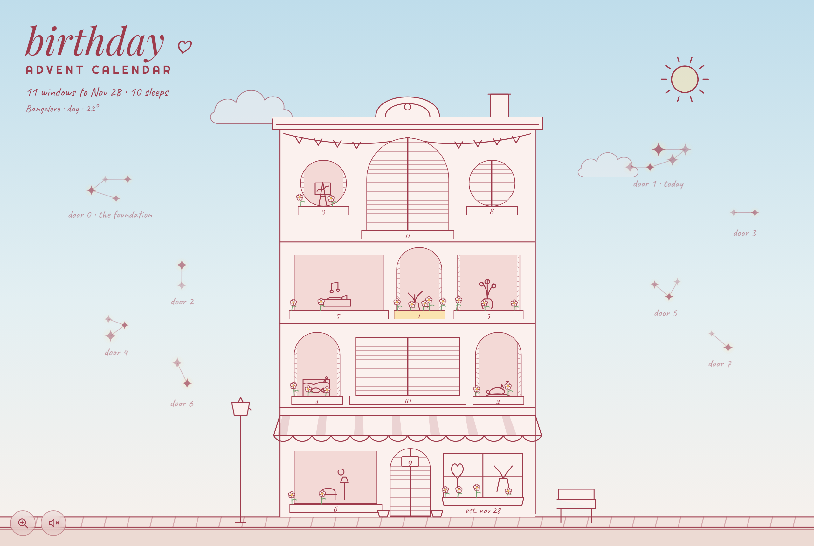
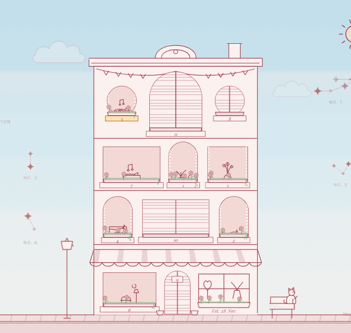
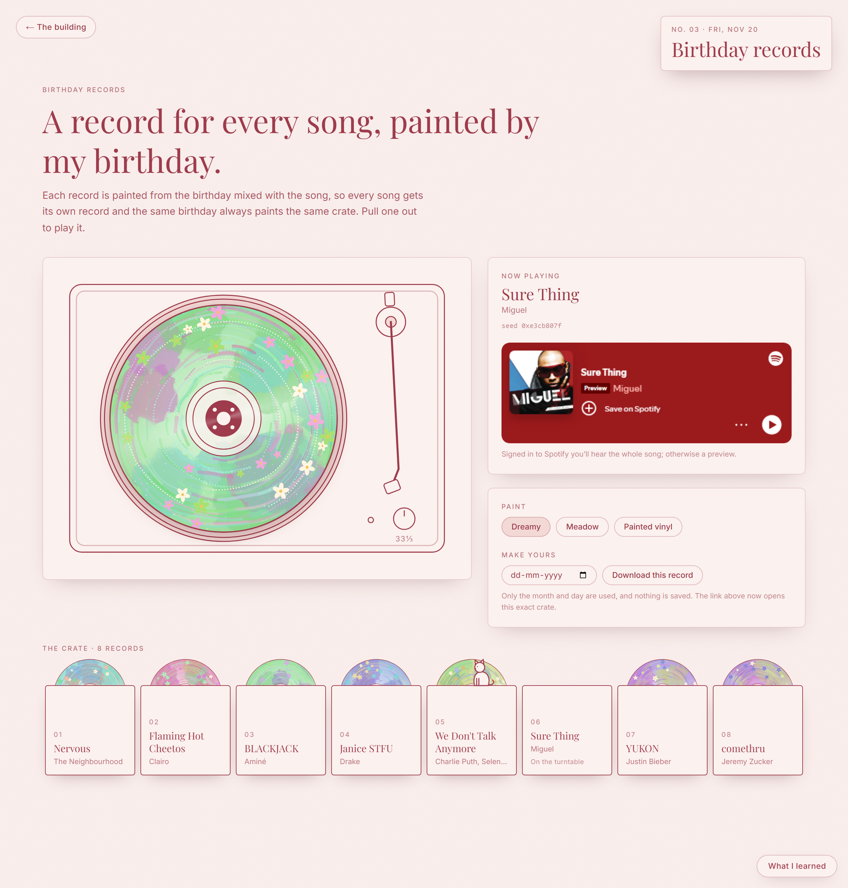
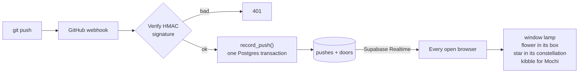

<div align="center">

# birthday advent calendar

**A hand-drawn building with eleven windows. One opens every day, and behind each one is a small thing I built that day.**

[Open the building](https://advent-birthday-hng9.vercel.app)
&nbsp;·&nbsp;
[Paint your birthday records](https://advent-birthday-hng9.vercel.app/door/3)
&nbsp;·&nbsp;
[Meet Mochi](https://advent-birthday-hng9.vercel.app/door/2)

<br/>

[](https://advent-birthday-hng9.vercel.app)


</div>

<p align="center"></p>
<p align="center"><sub>Hover a window and its shutters swing open on a tiny room. Click an open one and the camera flies through the glass into that day's build.</sub></p>

## What this is

Advent calendars are fun: a little door to open every day, and something
waiting behind it. This is one for the web, made for anyone to visit, poke at
and come back to.

There are eleven windows. Each day one more opens (midnight, India time), and
behind it is a small, self-contained build: a pet that lives on the page, a
greenhouse, a crate of painted records, and more on the way. Every build is
something I wanted to learn, and every one is drawn in the same fine rose
line, so they all feel like rooms of one building.

The building is also **alive**. It's connected to my GitHub, so every time I
push code it changes for whoever has it open: a window lights up, a flower
grows in its window box, a star joins that day's constellation, and a piece of
kibble drops for Mochi, the cat who lives here.

### Things to try

- **Open a window.** Hover for a peek, click to fly inside. Windows for days
  still to come rattle but won't open.
- **Find the cat.** Mochi wanders every page. Bring your cursor near her and
  she chases it; click her and she purrs; leave her alone and she naps.
- **Paint your own records.** On door 3, enter your birthday and every song in
  the crate gets a record painted from it. Download yours or share the link.
- **Come back at night.** The sky is Bangalore's real sky, the lamps come on in
  the windows that have been worked in, and tomorrow there's a new door.

---

## Door 0 · The building



**What you're seeing:** the whole calendar. Shuttered windows are days still to
come; open ones show a tiny room hinting at that day's build. The flowers in
each window box are that day's pushes, one flower each, and the dotted shapes
in the sky are the same pushes as constellations. Mochi is on the bench,
bottom right. The sky behind is the real one over Bangalore right now.

**How it works**

- **The server owns the clock.** Which doors are open is decided on the server,
  in India time, and a sealed door's page never sends its content to the
  browser, so changing your clock doesn't help.
- **The real sky.** Phase (dawn, day, dusk, night) and rain come from the
  Open-Meteo API, cached for ten minutes so every visitor shares one request.
- **Windows are real buttons.** Shutters are two CSS 3D panels; the fly-through
  grows the window's rectangle to full screen and lands on the door's page.
- **Phones get an elevator.** The camera rides between floors with a dial,
  swipes or arrow keys, and a zoom mode makes everything bigger for anyone who
  needs it.

<details>
<summary><b>The interesting bit: a webhook that can't count a push twice</b></summary>

GitHub retries webhook deliveries, so the same push can arrive more than once.
The delivery ID is a unique key, and recording the push, lighting the window
and shipping any tagged door happen in one Postgres function, so it's atomic
and idempotent:

```sql
insert into pushes (delivery_id, repo, sha, message, pushed_at, ist_date, files)
values (p_delivery_id, p_repo, p_sha, p_message, p_pushed_at, p_ist_date, p_files)
on conflict (delivery_id) do nothing;

if not found then
  return jsonb_build_object('duplicate', true);   -- a retry: nothing happens
end if;
```

Before any of that, the route checks GitHub's HMAC-SHA256 signature over the
raw request body, with a constant-time comparison. Forged pushes get a `401`.
</details>

## Door 1 · The living garden


**What you're seeing:** a glass greenhouse at night. Each pot on the bench is
one door, and each stem in a pot is one push on that day, so busy days grow
bushy plants. The petal colours show what the push touched (pink for
TypeScript, yellow for CSS, mint for SQL, lilac for Markdown), and the card
on the left is what you get when you hover a flower: the commit that grew it.
Outside the glass, the same pushes are stars.
[Visit the greenhouse.](https://advent-birthday-hng9.vercel.app/door/1)

**How it works**

- The webhook sorts every changed file by kind, and the petals split between
  those colours in proportion.
- Five species (cosmos, tulip, bellflower, lavender, rose) are picked by the
  commit's SHA, so a commit always grows the same flower.
- Supabase Realtime streams each new push to every open page, where the stem
  grows in about a second.

<details>
<summary><b>The interesting bit: a hydration bug from <code>Math.cos</code></b></summary>

Flowers and stars are seeded from the commit SHA, so the server and the
browser should draw identical SVG. They didn't: Node and browsers can disagree
on the last digit of a trig result, which is enough to break React hydration.
The fix was integer-only hashing (`Math.imul`), rounded coordinates, and
precomputed direction tables instead of `Math.cos` in anything rendered on the
server.
</details>

## Door 2 · Mochi, the coding pet

<p align="center"></p>

**What you're seeing:** two treats drop onto the building and Mochi goes after
them, walking along the window boxes and pavement and jumping up the façade to
the roof. Nobody scripted those moves: she works out each route herself, live,
from the ledges on the page. On [her page](https://advent-birthday-hng9.vercel.app/door/2),
"Show her route" draws what she's thinking: the ledges she can stand on and the
path she's planned.


**On her page:** what she's doing right now, how hungry she is, and a live
diagram of her brain that lights up as she changes state.

**How it works**

- **A statechart brain** (XState): idle, wander, sit, groom, chase, watch,
  hungry, toFood, eating, purr, asleep. It only decides *what* she wants.
- **The page is her level.** Anything marked `data-mochi-platform` becomes a
  one-way ledge, re-measured every frame while the page zooms and scrolls.
  A\* search over (ledge, x) states finds the cheapest mix of walks and jumps.
- **Real jumps.** Each one is a projectile arc through an apex above the higher
  ledge: y = y₀ + v₀t + ½gt².
- **Hunger comes from the push log**, not a timer: it's the time since the last
  push, so every device agrees on how hungry she is.

<details>
<summary><b>The interesting bit: brain and body, kept apart</b></summary>

The statechart never touches the page. It wants things, and the animation loop
plans a route, walks and jumps, then reports back with events:

```ts
chase:  { on: { ARRIVED: "watch", CURSOR_LEFT: "idle" } },
toFood: { on: { ARRIVED: "eating", FOOD_GONE: "idle" } },
eating: { after: { eat: { target: "idle", actions: [emit({ type: "ate" })] } } },
```

Delays and randomness are injectable (`machine.provide(...)`), so every
behaviour (napping when bored, food interrupting play, never being interrupted
mid-bite) has a plain `node:test` unit test, and so do the A\* planner and the
jump maths. The diagram on her page is drawn from the machine definition
itself, so it can't drift from the code.
</details>

## Door 3 · Birthday records

<p align="center"></p>

**What you're seeing:** a record from the crate dropping onto the turntable.
The platter spins up, the tonearm swings across, and then the paint theme
changes twice (Dreamy, Meadow, Painted vinyl). It's the same record each time,
painted three ways from the same seed, so it keeps its colours.



**On the page:** the turntable, the Spotify player for the song that's on, the
paint and "make yours" controls, and the crate: eight songs, each with its own
record. [Paint your own crate.](https://advent-birthday-hng9.vercel.app/door/3)

**How it works**

- **Birthday × song.** Each record's seed mixes a birthday (month and day only,
  never the year) with the song's Spotify ID. Every song looks different, and
  the same birthday always paints the same crate.
- **Spotify's iFrame API** plays the song and reports its position, which is
  all the tonearm needs. Signed-in listeners hear the whole song; everyone
  else hears a preview.
- **A turntable with weight.** The platter eases up to 33⅓ rpm and coasts down,
  and the sheen stays still while the record turns, which is what sells the
  spin.
- **Shareable and printable.** Birthday and theme live in the URL, and any
  record downloads as a 3000 px PNG.

<details>
<summary><b>The interesting bit: plan, then paint</b></summary>

Painting is split in two. `plan()` is pure: seed in, a list of brush
instructions out (watercolour blobs, swirls, dotted rings, flowers), in
"record units" where the disc has radius 1. `render()` is a thin loop that
paints a plan at any size.

```ts
export const recordSeed = (birthday: string, trackId: string) =>
  hashString(`${birthday}:${trackId}`);

plan(birthday, trackId, "meadow");   // → { seed, hue, brushes: [...] }, identical on every device
```

That split makes the art testable without a canvas: determinism, every mark on
the disc, and flowers that never crowd each other (Poisson-disc sampling). The
watercolour look is dozens of nearly transparent layers of a recursively
deformed polygon, not one soft blob.
</details>

---

## More of the building

<table>
<tr>
<td width="50%"></td>
<td width="50%"></td>
</tr>
<tr>
<td><sub><b>At night</b> the sky turns dark, the stars come out, and a lamp glows in every window that has been worked in.</sub></td>
<td><sub><b>On the last day</b> every window lights up, a cake appears on the top floor, and fireworks go off over the roof.</sub></td>
</tr>
</table>

<table>
<tr>
<td width="62%"></td>
<td width="38%"></td>
</tr>
<tr>
<td><sub><b>Zoom mode</b> makes the windows and text much bigger, one floor at a time; the arrow keys ride between floors.</sub></td>
<td><sub><b>On phones</b> a brass elevator dial moves the camera between floors.</sub></td>
</tr>
</table>

## The doors

One door a day, about two hours of building each, each one something new to
learn.

| Door | Build | What it explores | |
|---|---|---|---|
| 0 | [The building](https://advent-birthday-hng9.vercel.app) | webhooks, realtime, server-side unlock rules | open |
| 1 | [The living garden](https://advent-birthday-hng9.vercel.app/door/1) | Supabase Realtime, seeded generative SVG | open |
| 2 | [Mochi, the coding pet](https://advent-birthday-hng9.vercel.app/door/2) | statecharts, A\* pathfinding, projectile physics | open |
| 3 | [Birthday records](https://advent-birthday-hng9.vercel.app/door/3) | seeded generative painting, Spotify iFrame API | open |
| 4 | GPU koi pond | spatial hashing, WebGPU | shuttered |
| 5 | Recursive flowers | L-systems, Rust → WASM | shuttered |
| 6 | Cozy room, real sky | caching, edge functions | shuttered |
| 7 | Firefly music | embeddings, clustering | shuttered |
| 8 | Holographic card | sensor APIs, OG images | shuttered |
| 9 | Time-locked letter | applied cryptography | shuttered |
| 10 | The game | ECS, deterministic replays | shuttered |
| 11 | Blow out the candles | signal processing | shuttered |

## How a push travels



1. **GitHub** sends a signed `push` event to `/api/github/webhook`.
2. The route **verifies the HMAC-SHA256 signature** over the raw body, in
   constant time.
3. It sorts the changed files by kind and calls **`record_push()`**: one
   transaction that records the push (deduplicated on the delivery ID), lights
   today's window, and opens any door tagged `door:N` in a commit message.
4. **Supabase Realtime** streams the new row over a websocket, and every open
   page grows the flower and the star and drops kibble, in about a second.

## Engineering notes

- **Resilient deploys.** The webhook and queries notice a database that hasn't
  had the latest migration yet and fall back instead of failing, so code and
  schema can ship in either order.
- **Deterministic everywhere.** Flowers, stars, constellations and records are
  all seeded with integer-only hashing, so every device draws the same thing.
- **Tested logic, thin rendering.** Mochi's brain, her route planner, the jump
  maths and the record painter are pure modules with `node:test` tests; the
  React components just draw what they return.
- **Private by default.** "Make yours" only uses a month and day, keeps it in
  the URL, and saves nothing.
- **Accessible.** Windows and Mochi are real buttons with spoken labels, there's
  a zoom mode and keyboard navigation, and all motion respects
  `prefers-reduced-motion`.
- **Home-made README animations.** The GIFs above are recorded by
  `scripts/animations.mjs`, which drives headless Chrome over the DevTools
  protocol and encodes frames with a small dependency-free GIF encoder
  (palette quantisation, changed-rectangle frames, LZW).

## Built with

| | |
|---|---|
| **Frontend** | Next.js 16 (App Router) · React 19 · TypeScript · Tailwind CSS 4 · Framer Motion · hand-drawn SVG · Canvas 2D |
| **Behaviour** | XState 5 statecharts · A\* pathfinding · projectile physics · seeded PRNG (mulberry32) |
| **Backend** | Next.js route handlers · Supabase (Postgres, Row Level Security, Realtime) |
| **Data** | GitHub push webhooks · Open-Meteo weather API · Spotify embed (iFrame API) |
| **Hosting** | Vercel (deploys on every push to `main`) |
| **Tooling** | pnpm workspaces · `node:test` · headless-Chrome screenshots and GIFs |

```
apps/web/                 the Next.js site
  app/page.tsx            the building (server: unlock rules, sky, pushes)
  app/door/[n]/           one page per door, sealed until its day
  app/api/github/webhook/ signed GitHub push → record_push()
  components/building/    façade, windows, window boxes, constellations, elevator
  components/mochi/       Mochi's drawing, runtime loop, live statechart diagram
  components/records/     record disc, turntable, crate, Spotify player hook
  lib/mochi/              her statechart and world model (A*, jump arcs), with tests
  lib/records/            the seeded record painter and the song list, with tests
  lib/                    unlock rules (IST), sky, constellations, file kinds
packages/garden-ui/       shared design tokens, motion presets, DoorFrame
scripts/                  README screenshots, animations and the GIF encoder
supabase/migrations/      schema, row-level security, seed, record_push()
```

## Run it yourself

The full guide covers running it locally with preview modes, then Supabase,
Vercel and the GitHub webhook: **[docs/SETUP.md](docs/SETUP.md)**.

```bash
pnpm install
cp apps/web/.env.example apps/web/.env.local   # set DEV_UNLOCK_ALL=true
pnpm dev                                       # http://localhost:3000/?preview=mixed
pnpm --filter web test                         # unit tests
pnpm screenshots && pnpm animations            # README images, with the dev server running
```

---

<div align="center">

A new door opens every day until the last one. Come back tomorrow.

<sub>Made by <a href="https://github.com/iivanhaj">@iivanhaj</a> ·
<a href="https://advent-birthday-hng9.vercel.app">advent-birthday-hng9.vercel.app</a></sub>

</div>
