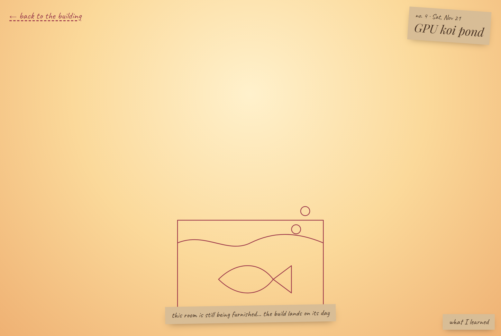

# birthday ♡ advent calendar

An advent calendar counting down to my birthday on **Nov 28**. It's a little
illustrated building with **11 windows**, one per day from Nov 18 to Nov 28.
Every day I ship one small build (a "door"), and its window lights up,
**live, the moment I push to GitHub**.


## What you're looking at

- **Each window is a door.** Hover (or tap) to open its shutters and peek at
  the tiny room inside; it hints at that day's build (a koi tank for the GPU
  koi pond, a record player for the music door, a letter for the time-locked
  letter…). Click an open window and the camera **flies through it** into that
  door's page, where the room fills the screen and that day's build lives:

  

- **Future windows stay shuttered.** The server decides what's open using
  India time, so changing your laptop clock doesn't help. Sealed door pages
  never even send their content to the browser.
- **The sky is real.** It's Bangalore's actual sky right now (dawn, day,
  dusk, night, rain) from the Open-Meteo weather API.
- **The lights are my progress.** Push code on a door's day and its shutters
  swing open; after sunset, every window I've worked on is lamp-lit.


- **Nov 28, the finale:** every window lights up floor by floor, the cake
  appears on the top floor, and fine-line fireworks go off over the roof.


Also: the building draws itself in when the page loads, rooms shift with your
mouse (or your phone's tilt) like a diorama, and shutters clack (sound is off
until you turn it on).

**Made for every screen and every eye.** The 🔍 **zoom button** enlarges the
building about 1.9× one floor at a time (↑/↓ to change floors, Esc to zoom
out), and on phones a brass **elevator** dial rides between floors.

<p align="center">
  
  &nbsp;
  
</p>

## The 11 doors

| # | Date | Build | What I'm learning |
|---|---|---|---|
| 1 | Wed 18 | The living garden | webhooks, HMAC, realtime |
| 2 | Thu 19 | Coding pet (PWA) | state machines, service workers |
| 3 | Fri 20 | Birthday-seeded art | seeded randomness, noise |
| 4 | Sat 21 | GPU koi pond | spatial hashing, WebGPU |
| 5 | Sun 22 | Recursive flowers | L-systems, Rust → WASM |
| 6 | Mon 23 | Cozy room, real sky | caching, edge functions |
| 7 | Tue 24 | Firefly music | embeddings, clustering |
| 8 | Wed 25 | Holographic card | sensor APIs, OG images |
| 9 | Thu 26 | Time-locked letter | applied cryptography |
| 10 | Fri 27 | Jae: The Game | ECS, deterministic replays |
| 11 | Sat 28 🎂 | Blow out the candles | signal processing |

---

# Go live: step by step

About 20 minutes, all free tiers. You need accounts on **GitHub** (done),
**Supabase** and **Vercel** (sign up for both with GitHub).

### Before you start: make a webhook secret

This is a password that GitHub and your site share, so the site can prove a
request really came from GitHub. Run this once and keep the output somewhere
safe (a password manager); you'll paste it in two places.

```bash
node -e "console.log(require('crypto').randomBytes(32).toString('hex'))"
```

## Part 1 · Supabase (the database)

1. Go to [supabase.com/dashboard](https://supabase.com/dashboard) → **New project**.
   - **Name:** `advent-birthday`
   - **Database password:** generate one and save it (you won't need it for this guide, but keep it).
   - **Region:** **South Asia (Mumbai)**, closest to Bangalore.
   - Click **Create new project** and wait about a minute while it sets up.
2. In the left sidebar open **SQL Editor** → **New query**.
3. Open [`supabase/migrations/20261117000000_init.sql`](supabase/migrations/20261117000000_init.sql)
   in this repo, copy **all** of it, paste it into the editor, click **Run**.
   You should see *"Success. No rows returned"*.
4. Check it worked: open **Table Editor** → **doors**. You should see 11 rows,
   Nov 18 to Nov 28, with empty `sprouted_at` / `shipped_at`.
5. Get your keys: **Project Settings** (gear icon) → **API Keys** (on older
   dashboards: **API**). Copy these three values into a note:

   | Name in Supabase | You'll paste it as | Safe to share? |
   |---|---|---|
   | **Project URL** (`https://xxxx.supabase.co`, under **Data API** / **API**) | `NEXT_PUBLIC_SUPABASE_URL` | yes |
   | **Publishable key** (`sb_publishable_…`), or legacy **anon** key | `NEXT_PUBLIC_SUPABASE_ANON_KEY` | yes: it can only read |
   | **Secret key** (`sb_secret_…`), or legacy **service_role** key | `SUPABASE_SERVICE_ROLE_KEY` | **never**: it can write anything |

## Part 2 · Vercel (hosting)

1. Go to [vercel.com/new](https://vercel.com/new) and pick **Import** next to
   **iivanhaj/advent-birthday** (if it isn't listed, click *Adjust GitHub App
   Permissions* and give Vercel access to the repo).
2. On the configure screen:
   - **Root Directory:** click **Edit** → choose **`apps/web`** → **Continue**.
     (This is the important one. Vercel still installs the whole pnpm workspace.)
   - **Framework Preset:** Next.js (detected automatically).
   - Leave build and install commands as they are.
3. Open **Environment Variables** and add these four (one at a time, name on
   the left, value on the right):

   | Name | Value |
   |---|---|
   | `NEXT_PUBLIC_SUPABASE_URL` | Project URL from Part 1 |
   | `NEXT_PUBLIC_SUPABASE_ANON_KEY` | publishable / anon key |
   | `SUPABASE_SERVICE_ROLE_KEY` | secret / service_role key |
   | `GITHUB_WEBHOOK_SECRET` | the secret you generated at the start |

   Do **not** add `DEV_UNLOCK_ALL`: that's only for local development (and it's
   ignored in production anyway).
4. Click **Deploy**. When it finishes you get a URL like
   `https://advent-birthday-xxxx.vercel.app`. Open it: the building should draw
   itself in, with every window still shuttered (Door 1 opens Nov 18 IST).
5. *(Optional)* Nicer address: **Project → Settings → Domains** → edit the
   `.vercel.app` name to something like `advent-birthday.vercel.app`, or add
   your own domain.

> Changed an environment variable after deploying? Go to **Deployments** →
> the latest one → **⋯ → Redeploy**. Variables only apply to new deployments.

From now on, every push to `main` redeploys automatically.

## Part 3 · GitHub webhook (makes windows light up)

1. Open [github.com/iivanhaj/advent-birthday/settings/hooks](https://github.com/iivanhaj/advent-birthday/settings/hooks)
   → **Add webhook**.
2. Fill in:
   - **Payload URL:** `https://<your-vercel-url>/api/github/webhook`
   - **Content type:** `application/json` (not the default form option)
   - **Secret:** the same secret you put in Vercel
   - **SSL verification:** enabled
   - **Which events?** *Just the push event.*
   - **Active:** ticked
3. Click **Add webhook**. GitHub immediately sends a test "ping". Click the
   webhook → **Recent Deliveries**: the ping should show a green tick and
   response `200 {"ok":true,"pong":true}`.
4. *(Optional)* Add the same webhook to your LeetCode solutions repo too, so
   your daily Blind 75 push also counts as "I pushed today".

## Part 4 · Check it end to end

On or after **Nov 18 (IST)**:

1. Open your site in one tab.
2. Push any commit. Within a couple of seconds, **window 1's shutters open**
   (and after sunset its lamp turns on), without refreshing.
3. In Supabase → **Table Editor → pushes** you'll see the push recorded, and
   in **doors**, row 1 has a `sprouted_at` time.
4. When Door 1 is done, ship it with a commit message containing **`door:1`**:

   ```bash
   git commit -m "feat: living garden door:1"
   git push
   ```

   In Supabase, row 1 now has a `shipped_at` time: the door is officially
   shipped (and counts toward the 11/11 finale).

> Only write `door:N` in the commit that actually ships door N; that tag is
> what marks it shipped. A future door can't be shipped early: the database
> ignores `door:N` before that door's date.

## Troubleshooting

| What you see | Why | Fix |
|---|---|---|
| Webhook delivery shows **401 bad signature** | Secrets don't match | Re-paste the same secret in GitHub and Vercel, then **Redeploy** in Vercel |
| **500 database not configured** | Supabase variables missing in Vercel | Add all three, then **Redeploy** |
| **500 database error** | Migration didn't run fully | Re-run the SQL from Part 1 in a fresh Supabase project, or check **Logs** in Supabase |
| Ping works but windows never change | Pushing before Nov 18, or to a tag | Only branch pushes on a door's date (IST) count |
| Window changes only after refresh | Realtime not streaming | The migration enables it; check **Database → Publications → supabase_realtime** includes `doors` |
| Site shows every window open | `DEV_UNLOCK_ALL` set in Vercel | Remove it and redeploy (it's ignored on production deployments, but not on previews) |

Every webhook delivery can be safely **Redelivered** from GitHub: duplicates
are detected and ignored.

---

## Run it locally

```bash
pnpm install
cp apps/web/.env.example apps/web/.env.local   # then fill it in, and set DEV_UNLOCK_ALL=true
pnpm dev                                       # http://localhost:3000
```

Without Supabase the calendar still renders (every window empty). Local-only
preview switches (need `DEV_UNLOCK_ALL=true`):

| URL | Shows |
|---|---|
| `/?preview=mixed` | some windows pushed / shipped |
| `/?preview=finale` | Nov 28: every lamp, fireworks |
| `/?sky=night` (`dawn`, `day`, `dusk`), `&rain=1` | force the sky |

### Refreshing the README screenshots

As doors ship, re-shoot the images in [`docs/screenshots/`](docs/screenshots/):

```bash
pnpm dev            # terminal 1 (needs DEV_UNLOCK_ALL=true)
pnpm screenshots    # terminal 2 → retina PNGs, about 45 seconds
```

It drives your installed Chrome or Edge headlessly (no extra packages) and
waits for every animation to finish before each shot. `ONLY=day,phone pnpm
screenshots` re-shoots just some of them.

## How it's built

```
apps/web/                 Next.js (App Router, TypeScript, Tailwind, Framer Motion)
  app/page.tsx            the building; server decides unlocks, sky, door data
  app/door/[n]/           one page per door (sealed until its date, server-side)
  app/api/github/webhook/ GitHub push → record it → light a window
  components/building/    façade, windows, sky, elevator, zoom, fireworks
  lib/                    unlock rules (IST), sky (Open-Meteo), webhook helpers
packages/garden-ui/       shared tokens, motion presets, DoorFrame
supabase/migrations/      schema, row-level security, seed, record_push()
```

**How a push becomes a lit window:** GitHub → `POST /api/github/webhook` →
verify signature → `record_push()` in Postgres → row change on `doors` →
Supabase Realtime → every open browser updates.

**Why the webhook is safe:**

- **Signed:** HMAC-SHA256 over the raw request body, compared in constant time
  (so response timing can't leak the signature). Anything unsigned gets `401`.
- **Idempotent:** GitHub's delivery ID is a unique key, so a redelivered event is a no-op.
- **Atomic:** recording the push, lighting today's window and shipping tagged
  doors happen in one database transaction; a crash can't half-record a push.
- **Least privilege:** the public key can only read. Only the server's secret
  key can call `record_push`, and only after the signature checks out.
