<div align="center">

# birthday advent calendar

**A hand-drawn building with eleven windows. One opens every day, and behind each one is a small thing I built that day.**

[Open the building](https://advent-birthday-hng9.vercel.app)
&nbsp;·&nbsp;
[Paint your birthday records](https://advent-birthday-hng9.vercel.app/door/3)
&nbsp;·&nbsp;
[Meet Mochi](https://advent-birthday-hng9.vercel.app/door/2)

<br/>

[](https://advent-birthday-hng9.vercel.app)


</div>

<p align="center">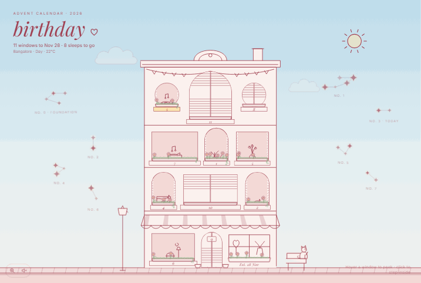</p>
<p align="center"><sub>Hover a window and its shutters swing open on a tiny room. Click an open one and the camera flies through the glass into that day's build.</sub></p>

## What this is

Advent calendars are fun: a little door to open every day, and something
waiting behind it. This is one for the web, made for anyone to visit, poke at
and come back to.

There are eleven windows. Each day one more opens (midnight, India time), and
behind it is a small, self-contained build: a pet that lives on the page, a
greenhouse, a crate of painted records, and more on the way. Every build is
something I wanted to learn, and every one is drawn in the same fine rose
line, so they all feel like rooms of one building.

The building is also **alive**. It's connected to my GitHub, so every time I
push code it changes for whoever has it open: a window lights up, a flower
grows in its window box, a star joins that day's constellation, and a piece of
kibble drops for Mochi, the cat who lives here.

### Things to try

- **Open a window.** Hover for a peek, click to fly inside. Windows for days
  still to come rattle but won't open.
- **Find the cat.** Mochi wanders every page. Bring your cursor near her and
  she chases it; click her and she purrs; leave her alone and she naps.
- **Paint your own records.** On door 3, enter your birthday and every song in
  the crate gets a record painted from it. Download yours or share the link.
- **Take a strip of photos.** On door 6, pose four times in rose ink or
  classic black and white, print it at the real 2 × 6 inch size and sign the
  guestbook.
- **Play the carousel.** On door 7, pick a mood, turn the carousel until a
  song you like is at the front, and let the music box wind it up.
- **Print your birthday card.** On door 8, put in a birthday and tilt your
  phone: the foil catches the light. Turn it over, save it, or share the link.
- **Run the rooftops.** On door 9, help Mochi leap across the roofs at dusk.
  Everyone gets the same course each day; share your run and it replays exactly.
- **Come back at night.** The sky is Bangalore's real sky, the lamps come on in
  the windows that have been worked in, and tomorrow there's a new door.

---

## Door 0 · The building


**What you're seeing:** the whole calendar. Shuttered windows are days still to
come; open ones show a tiny room hinting at that day's build. The flowers in
each window box are that day's pushes, one flower each, and the dotted shapes
in the sky are the same pushes as constellations. Mochi is on the bench,
bottom right. The sky behind is the real one over Bangalore right now.

**How it works**

- **The server owns the clock.** Which doors are open is decided on the server,
  in India time, and a sealed door's page never sends its content to the
  browser, so changing your clock doesn't help.
- **The real sky.** Phase (dawn, day, dusk, night) and rain come from the
  Open-Meteo API, cached for ten minutes so every visitor shares one request.
- **Windows are real buttons.** Shutters are two CSS 3D panels; the fly-through
  grows the window's rectangle to full screen and lands on the door's page.
- **Phones get an elevator.** The camera rides between floors with a dial,
  swipes or arrow keys, and a zoom mode makes everything bigger for anyone who
  needs it.

<details>
<summary><b>The interesting bit: a webhook that can't count a push twice</b></summary>

GitHub retries webhook deliveries, so the same push can arrive more than once.
The delivery ID is a unique key, and recording the push, lighting the window
and shipping any tagged door happen in one Postgres function, so it's atomic
and idempotent:

```sql
insert into pushes (delivery_id, repo, sha, message, pushed_at, ist_date, files)
values (p_delivery_id, p_repo, p_sha, p_message, p_pushed_at, p_ist_date, p_files)
on conflict (delivery_id) do nothing;

if not found then
  return jsonb_build_object('duplicate', true);   -- a retry: nothing happens
end if;
```

Before any of that, the route checks GitHub's HMAC-SHA256 signature over the
raw request body, with a constant-time comparison. Forged pushes get a `401`.
</details>

## Door 1 · The living garden

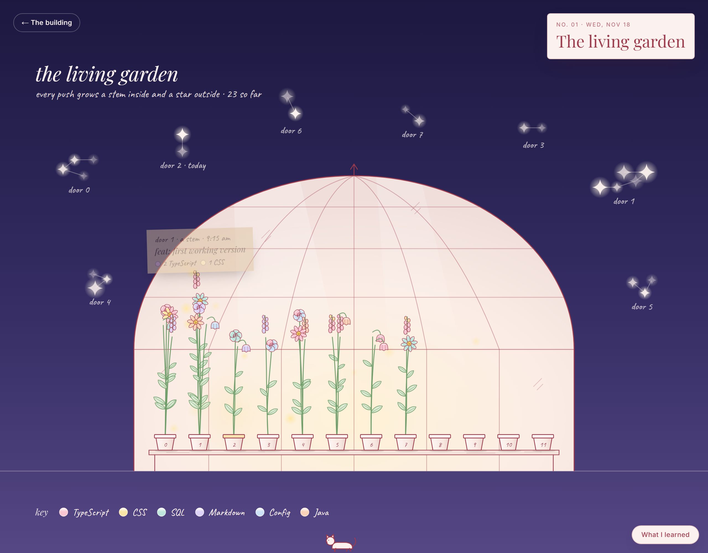

**What you're seeing:** a glass greenhouse at night. Each pot on the bench is
one door, and each stem in a pot is one push on that day, so busy days grow
bushy plants. The petal colours show what the push touched (pink for
TypeScript, yellow for CSS, mint for SQL, lilac for Markdown), and the card
on the left is what you get when you hover a flower: the commit that grew it.
Outside the glass, the same pushes are stars.
[Visit the greenhouse.](https://advent-birthday-hng9.vercel.app/door/1)

**How it works**

- The webhook sorts every changed file by kind, and the petals split between
  those colours in proportion.
- Five species (cosmos, tulip, bellflower, lavender, rose) are picked by the
  commit's SHA, so a commit always grows the same flower.
- Supabase Realtime streams each new push to every open page, where the stem
  grows in about a second.

<details>
<summary><b>The interesting bit: a hydration bug from <code>Math.cos</code></b></summary>

Flowers and stars are seeded from the commit SHA, so the server and the
browser should draw identical SVG. They didn't: Node and browsers can disagree
on the last digit of a trig result, which is enough to break React hydration.
The fix was integer-only hashing (`Math.imul`), rounded coordinates, and
precomputed direction tables instead of `Math.cos` in anything rendered on the
server.
</details>

## Door 2 · Mochi, the coding pet

<p align="center"></p>

**What you're seeing:** two treats drop onto the building and Mochi goes after
them, walking along the window boxes and pavement and jumping up the façade to
the roof. Nobody scripted those moves: she works out each route herself, live,
from the ledges on the page. On [her page](https://advent-birthday-hng9.vercel.app/door/2),
"Show her route" draws what she's thinking: the ledges she can stand on and the
path she's planned.


**On her page:** what she's doing right now, how hungry she is, and a live
diagram of her brain that lights up as she changes state.

**How it works**

- **A statechart brain** (XState): idle, wander, sit, groom, chase, watch,
  hungry, toFood, eating, purr, asleep. It only decides *what* she wants.
- **The page is her level.** Anything marked `data-mochi-platform` becomes a
  one-way ledge, re-measured every frame while the page zooms and scrolls.
  A\* search over (ledge, x) states finds the cheapest mix of walks and jumps.
- **Real jumps.** Each one is a projectile arc through an apex above the higher
  ledge: y = y₀ + v₀t + ½gt².
- **Hunger comes from the push log**, not a timer: it's the time since the last
  push, so every device agrees on how hungry she is.

<details>
<summary><b>The interesting bit: brain and body, kept apart</b></summary>

The statechart never touches the page. It wants things, and the animation loop
plans a route, walks and jumps, then reports back with events:

```ts
chase:  { on: { ARRIVED: "watch", CURSOR_LEFT: "idle" } },
toFood: { on: { ARRIVED: "eating", FOOD_GONE: "idle" } },
eating: { after: { eat: { target: "idle", actions: [emit({ type: "ate" })] } } },
```

Delays and randomness are injectable (`machine.provide(...)`), so every
behaviour (napping when bored, food interrupting play, never being interrupted
mid-bite) has a plain `node:test` unit test, and so do the A\* planner and the
jump maths. The diagram on her page is drawn from the machine definition
itself, so it can't drift from the code.
</details>

## Door 3 · Birthday records

<p align="center">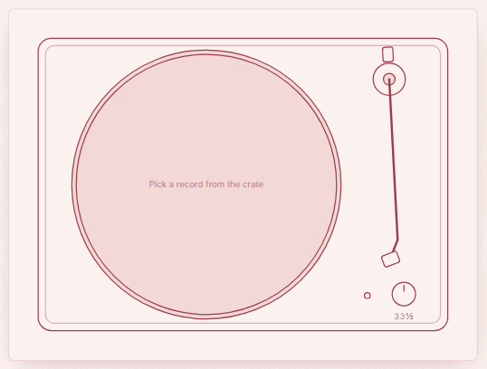</p>

**What you're seeing:** a record from the crate dropping onto the turntable.
The platter spins up, the tonearm swings across, and then the paint theme
changes twice (Dreamy, Meadow, Painted vinyl). It's the same record each time,
painted three ways from the same seed, so it keeps its colours.


**On the page:** the turntable, the Spotify player for the song that's on, the
paint and "make yours" controls, and the crate: eight songs, each with its own
record. [Paint your own crate.](https://advent-birthday-hng9.vercel.app/door/3)

**How it works**

- **Birthday × song.** Each record's seed mixes a birthday (month and day only,
  never the year) with the song's Spotify ID. Every song looks different, and
  the same birthday always paints the same crate.
- **Spotify's iFrame API** plays the song and reports its position, which is
  all the tonearm needs. Signed-in listeners hear the whole song; everyone
  else hears a preview.
- **A turntable with weight.** The platter eases up to 33⅓ rpm and coasts down,
  and the sheen stays still while the record turns, which is what sells the
  spin.
- **Shareable and printable.** Birthday and theme live in the URL, and any
  record downloads as a 3000 px PNG.

<details>
<summary><b>The interesting bit: plan, then paint</b></summary>

Painting is split in two. `plan()` is pure: seed in, a list of brush
instructions out (watercolour blobs, swirls, dotted rings, flowers), in
"record units" where the disc has radius 1. `render()` is a thin loop that
paints a plan at any size.

```ts
export const recordSeed = (birthday: string, trackId: string) =>
  hashString(`${birthday}:${trackId}`);

plan(birthday, trackId, "meadow");   // → { seed, hue, brushes: [...] }, identical on every device
```

That split makes the art testable without a canvas: determinism, every mark on
the disc, and flowers that never crowd each other (Poisson-disc sampling). The
watercolour look is dozens of nearly transparent layers of a recursively
deformed polygon, not one soft blob.
</details>

## Door 4 · The commit pond

<p align="center">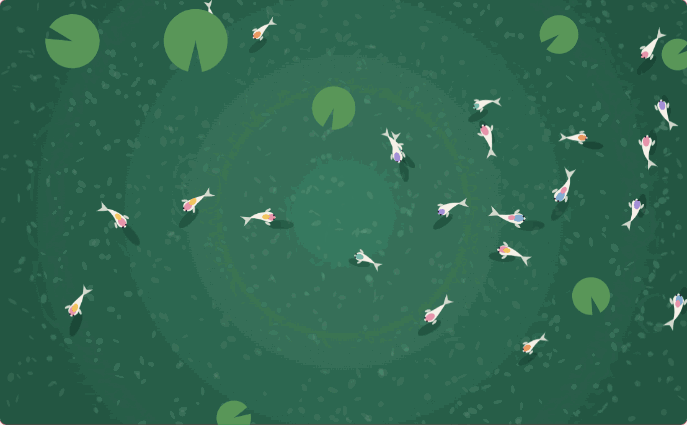</p>

**What you're seeing:** a pond where **every koi is one of my pushes**. Each
koi's colour patches are the kinds of files that push touched (pink for
TypeScript, yellow for CSS, mint for SQL, lilac for Markdown), its size is how
many, and koi from the same day swim together as a school. Clicks send ripples
across the water and the koi scatter. Then the pond changes look: it follows
Bangalore's real sky, a sunlit garden by day, ink and watercolour at dusk, and
lanterns at night. [Visit the pond](https://advent-birthday-hng9.vercel.app/door/4), hover a koi to see its commit,
and leave it open: the next push drops a new koi in with a splash.

<p align="center">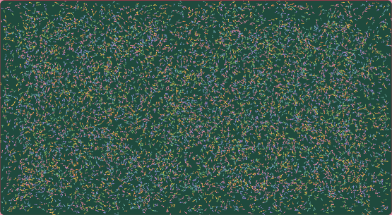</p>

**The stress test:** the same flocking rules at a scale a CPU can't keep up
with: 10,000 koi, simulated and drawn entirely on the GPU, with a live
CPU-versus-GPU comparison of frame rate and pairs compared per frame.

**How it works**

- **Flocking (boids).** Every koi follows three local rules: keep your
  distance from everyone, swim the way your school swims, and drift toward
  your school's centre. Schooling emerges from that alone.
- **A spatial hash** files every koi under a grid cell the size of its sight
  range, so each one only checks the 3 × 3 cells around it instead of the
  whole pond. A test proves it finds exactly the same neighbours as checking
  everyone, with a fraction of the work.
- **Real water on the GPU.** The surface is a grid solving the wave equation in
  a WebGL2 shader every frame. Its slope bends the view of the pond floor and
  its curvature focuses light into caustics. The koi swim in a crisp layer
  above it, so the water never blurs them; they just leave soft wakes.
- **WebGPU compute for 10,000 koi.** A WGSL compute shader updates every koi
  in parallel, and an instanced render pipeline draws them all in one call,
  reading straight from the same GPU buffer.

<details>
<summary><b>The interesting bit: a hundred million comparisons a frame</b></summary>

The GPU version doesn't bother with a hash: it compares every koi with every
other one, 10,000 × 9,999 pairs a frame. The trick is tiling. Each workgroup
of 256 threads loads 256 koi into fast shared memory, every thread compares its
own koi against that tile, and they move on together:

```wgsl
for (var t = 0u; t < tiles; t++) {
  tile[li] = src[t * 256u + li];      // each thread loads one koi into the shared tile
  workgroupBarrier();
  for (var m = 0u; m < 256u; m++) {   // ...then everyone compares against all 256
    let d = tile[m].pos - me.pos;
    // separation from everyone, alignment and cohesion within my school
  }
  workgroupBarrier();
}
```

The water uses the same idea at a smaller scale: one shader invocation per grid
cell, all at once, `next = (left + right + up + down) / 2 − previous`, with a
little damping so ripples fade.
</details>

## Door 5 · The infinite bloom

<p align="center">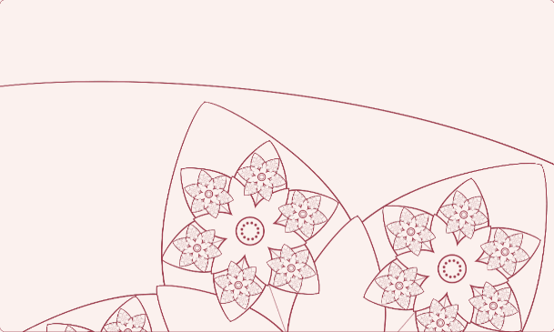</p>

**What you're seeing:** a flower whose every petal holds a smaller copy of the
whole flower, so you can zoom in forever and it never runs out. The camera
spirals into one petal until the small flower there becomes the big one, and
keeps going. It's drawn in fine ink by day and in glowing glass at night (it
follows the real sky, or you pick). [Open the bloom](https://advent-birthday-hng9.vercel.app/door/5), click any
petal to dive into that one instead, scroll to speed up or zoom back out, and
change the petals, nesting and twist to grow a different infinite flower. The
link remembers your flower.

**How it works**

- **Self-similarity.** Stepping from a flower into its petal is one fixed
  transformation M (shrink, turn, shift). The camera follows M^t, a smooth
  "fraction" of that step, spiralling around the one point M leaves in place.
  At t = 1 the picture is exactly the one at t = 0, so t wraps back and the
  zoom is seamless forever. Wrapping also keeps every number small, so there's
  no floating-point "deep zoom" limit.
- **Only what you can see.** Each frame walks the infinite tree from a few
  levels above the screen and skips any flower that's off screen or too small,
  along with everything nested inside it. Tests prove the zoom loops exactly
  and that this culling never drops a visible flower.
- **Drawn on the GPU.** Every flower is one instanced quad; a fragment shader
  draws its petals as signed distance fields, so a 1 px ink line stays 1 px wide
  on a flower 4 px or 4,000 px across, and glass petals add light to each other.
- **Rust and WebAssembly.** The tree walk exists twice, in TypeScript and in
  Rust compiled to a 30 KB WebAssembly module, and the page races them live. A
  test loads the real `.wasm` and checks both return exactly the same flowers.
  At full detail the Rust walk is about 2 to 3 times faster.

<details>
<summary><b>The interesting bit: a NaN that drew straight lines</b></summary>

The first version drew long straight lines shooting out of every petal tip.
Each petal's width comes from `pow(sin(π · u), 0.75)`, and past the tip `u`
is 1, but `sin(π)` in floating point is a hair below zero, and a negative
number to a fractional power is NaN. The NaN slipped through the outline test
along a line. The fix is one `max`:

```glsl
// past the tip sin(π) comes out a hair below zero, and pow() of a negative is NaN
float halfW = W * L * pow(max(sin(PI * u), 0.0), 0.75) * (1.0 - 0.28 * u);
```

The Rust side needs no wasm-bindgen: it exports two plain functions,
`alloc_out` and `walk`, and the page reads the flowers straight out of the
module's memory as a `Float32Array`, then hands that same array to the GPU.
</details>

---

## Door 6 · The photo booth

<p align="center">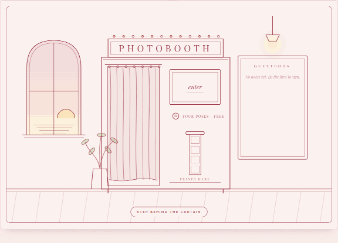</p>

**What you're seeing:** an old-fashioned photo booth, drawn in the same line as
the rest of the building, standing in a room whose window shows Bangalore's
real sky. [Step behind the curtain](https://advent-birthday-hng9.vercel.app/door/6)
and the booth prints you live, in rose ink on cream paper or as a classic
black-and-white booth strip, with a little strip beside the viewfinder showing
exactly how your frame will look. Count down four poses and the strip slides
out: press stamps on it, save it, or print it at the real 2 × 6 inch size. Then sign the guestbook on the wall, which fills in
live for everyone. The photos never leave your screen; only the guestbook's
words are kept.

**How it works**

- **Developed live on the GPU.** Every camera frame goes through three
  shader passes. The first reads the camera and sets the exposure from the
  frame's average brightness, which is free: the top level of a texture's
  mipmap chain *is* the average of every pixel. The next two blur it very
  slightly, across and then down (a Gaussian blur splits into two 1D passes,
  so it costs far fewer reads), which calms webcam noise. The last prints it in
  rose ink or black-and-white silver with grain. The same maths in TypeScript is
  tested and takes over on browsers without WebGL2.
- **See the strip before you shoot.** A few times a second the booth paints
  the whole strip beside the viewfinder: the poses you've taken so far, then the
  live view in every window still to fill, inside the frame you've chosen.
- **The canvas is the print.** A strip is 2 × 6 inches, and at 300 dots per
  inch that's exactly 600 × 1800 pixels, so the strip is painted at print size
  and printing just hands that image to a page whose CSS `@page` is 2 × 6
  inches. No resizing between the screen and the paper.
- **The sky on the film.** The window's wash, and the line printed along the
  bottom of every strip (place, date, time, sky and temperature), come from
  the same live Bangalore weather as the rest of the building.
- **A guestbook that stays kind.** Notes are checked on the page, again by the
  API (length, no links, a word filter that catches `sh1t` and `s.h.i.t`), and
  a third time by the table's own constraints. A sliding-window rate limit
  allows three notes per ten minutes per visitor, and new notes reach every
  open booth through Supabase Realtime.

<details>
<summary><b>The interesting bit: telling visitors apart without knowing who they are</b></summary>

A rate limit needs to know whether two requests came from the same person,
but storing IP addresses would mean keeping personal data for a guestbook.
So the server keeps a keyed hash of the address instead:

```ts
const visitor = createHmac("sha256", secret).update(`guestbook:${ip}`).digest("hex").slice(0, 32);
```

The same visitor always gets the same hash, so the limit works, but without
the server's secret nobody can test guesses against it, and the address
itself is never written down. Those rows are invisible to the public key and
are cleared after a day.
</details>

---

## Door 7 · The firefly carousel

<p align="center">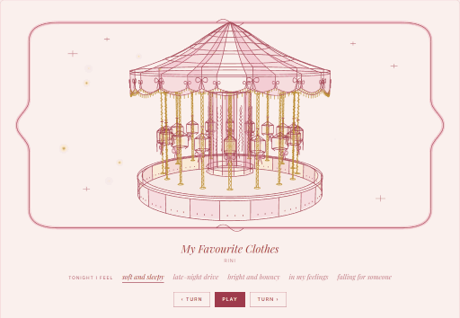</p>

**What you're seeing:** a music-box carousel, drawn in 3D but only in the
building's fine lines and a few pale washes. Every pole carries a glass lantern
with a firefly inside, and every firefly is one of 87 songs from a playlist.
[Pick a mood](https://advent-birthday-hng9.vercel.app/door/7), turn the
carousel until the song you want is at the front, and press play: the box
winds up a little tune of its own for that song, then the song plays through
Spotify while the carousel turns and the lanterns rise and fall.

**How it works**

- **Every song is a point in a mood space.** Each one has six scores (energy,
  brightness, romance, longing, haze, night), so songs that feel alike sit
  close together.
- **The moods come from clustering.** k-means++ picks five far-apart starting
  points and k-means settles them into groups, over a dozen seeded restarts,
  keeping the tightest. Each group is then named by trying every pairing of
  groups to five named moods (5! = 120) and keeping the closest.
- **Every carousel is full.** Plain k-means happily makes one group of 30 and
  another of 6. Here assignment hands out the closest song–group pairs first
  and stops filling a group at ⌈87 / 5⌉, so every carousel gets 16 to 18 songs.
- **Neighbours sound alike.** Each carousel is a loop, so the songs are ordered
  by a nearest-neighbour tour through their mood points, tidied with 2-opt
  (reverse any stretch that makes the loop shorter) until nothing improves.
  Turning the carousel drifts gently from one feeling to the next.
- **Drawn in lines, in three.js.** No models: the base, the barley-twist brass
  poles, the scalloped canopy, the bows and the lanterns are line segments
  built from a handful of curves, with see-through stripes for colour. The
  fireflies are glowing point sprites drawn last, so the stripes never cover them.
- **A music box with no audio files.** Each note is a sine with two quiet
  overtones that fade faster than it does, like a plucked steel tooth, made
  with the Web Audio API. The tune is seeded with the song's Spotify ID, so
  every song has its own.

<details>
<summary><b>The interesting bit: keeping clusters the same size</b></summary>

k-means on its own only minimises distance, so nothing stops one mood from
swallowing a third of the playlist. The balanced version changes one step,
the assignment:

```ts
pairs.sort((a, b) => a.distance - b.distance);  // every (song, group) pair, closest first
for (const { song, group } of pairs) {
  if (assigned[song] || size[group] >= cap) continue;
  assigned[song] = group;
  size[group]++;
}
```

Every song still goes to the nearest group with room for it, the centres
then move to the middle of their songs, and it repeats until nothing changes.
It's all pure TypeScript with tests: the clusters come out the same on every
build, every song lands on exactly one carousel, and the ring order is never
longer than the playlist's own order.
</details>

---

## Door 8 · The holographic card

<p align="center">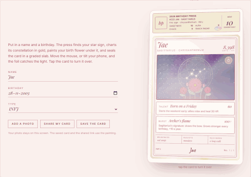</p>

**What you're seeing:** a collectible card made from a birthday, sealed in
a graded slab. [Put in a name and a date](https://advent-birthday-hng9.vercel.app/door/8)
and the press finds the star sign, charts its constellation in gold, paints
that month's birth flower beneath it, and works out the rest: days on earth as
HP, the weekday you were born as your talent, your sign's signature move.
Move the mouse or tilt your phone and the foil catches the light; tap the card
to turn it over.

**How it works**

- **One light, many layers.** The tilt, the gilt edge's highlight, two foil
  layers, the glitter and the glare all read two CSS variables: where the
  light is. They're eased every frame and written straight to the element, so
  nothing re-renders while the card moves.
- **The phone's gyroscope.** On phones the light comes from
  `DeviceOrientationEvent`: `gamma` moves it left and right, `beta` up and
  down. iPhones only hand it over after a tap, so the page asks with a small
  "tilt with your phone" link.
- **Painted in code, per month.** Each birth flower is a recipe (how many
  petals, how long and wide, the tip, the layers, two colours) drawn as Bézier
  petals that shade from the heart outwards. Each sign's stars carry a
  brightness, so the constellation reads like a real one.
- **Star signs, tested at every edge.** A sign is the one whose season began
  on or before your day, so the code needs only twelve start days. A test walks
  every day of a leap year and checks the signs come out in order, each one
  starting on its own day and not the day before.
- **The same card everywhere.** Nothing is random: a card is a pure function
  of name, birthday and type, hashed for its stats and serial. A shared link
  carries just those three, and its preview image is drawn on the server by
  Satori from the same painting, so the link previews the very card.
- **The engraved back** is a guilloche, the looping lines on banknotes, made
  of three hypotrochoids round a medallion.

<details>
<summary><b>The interesting bit: why the flip kept breaking</b></summary>

A card flip is two faces back to back inside a parent with
`transform-style: preserve-3d`, each with `backface-visibility: hidden`. It
worked until the glare went on top: any child with a `mix-blend-mode` makes
the browser composite its parent as one flat picture, and a flat picture has
no back face to hide. The front showed through, mirrored. The fix is
structural, not a tweak: every blended layer (foil, glitter, glare) lives
inside the face it shines on, so the 3D parent only ever holds two plain faces.
</details>

---

## Door 9 · Mochi's rooftop run

<p align="center">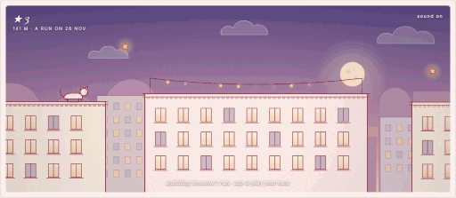</p>

**What you're seeing:** a small game starring Mochi, the cat who lives on
this site. [She's slipped out onto the rooftops](https://advent-birthday-hng9.vercel.app/door/9)
at dusk: tap (or press space) to jump, hold to leap further, catch the stars
and the slices of cake, bounce off the striped awnings and mind the pigeons.
The sky deepens into night the further she gets. Everyone runs the same
rooftops today; tomorrow there are new ones. Finish a run and share it: the
link plays it back, exactly.

**How it works**

- **The game is pure maths.** The world grows from a seed (today's date), and
  the simulation moves in fixed 1/60 s steps using nothing but the button. So
  the same day and the same presses always give the same run, on any screen.
- **A fixed timestep.** The screen draws whenever it likes, but real time is
  collected and spent in whole simulation steps, so a 60 Hz phone and a 144 Hz
  monitor play identically.
- **A replay is a list of frames.** Only the frames where the button went
  down or up are kept, as gaps in base 36: a whole run fits in about fifty
  characters after the `#` of a link. Playing it back is re-running the
  simulation with those presses.
- **Fair jumps.** A few frames of grace after running off an edge (coyote
  time) and before landing (a jump buffer), and a scramble up onto a roof she
  only just misses.
- **Drawn like the building.** Canvas 2D in the site's rose line: a sky that
  blends from dusk to night, a skyline and a row of houses moving at their own
  fraction of her speed, lamplit windows, and Mochi built from the same shapes
  as her sprite. The sounds are synthesised: each star's bell climbs a
  pentatonic scale as you catch them in a row.

<details>
<summary><b>The interesting bit: a robot that plays every course</b></summary>

A generated course is only fair if it can be finished, so the tests include
a small robot player: at every roof edge it jumps, holding longer for a
longer gap, the way a person would. It runs a week of daily courses for a
minute each. It earned its keep at once: it found an awning that launched
Mochi straight into the wall of a taller roof, and a short roof a full jump
would overshoot. Now awnings only appear where the bounce lands safely, and
roofs get roomier as she speeds up.
</details>

---

## Door 10 · Birthday eve

<p align="center">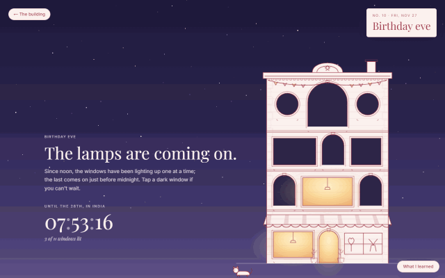</p>

**What you're seeing:** [the night before the birthday](https://advent-birthday-hng9.vercel.app/door/10).
The building stands under the stars and its lamps come on one window at a
time, from noon until the last one just before midnight, beside a countdown
to the 28th. Tap a dark window if you can't wait.

**How it works**

- **One clock for everyone.** The number of lit windows is the fraction of
  the day gone since noon in India, rounded down to a window, so every visitor
  sees the same building at the same moment. The countdown is two timestamps
  apart; `Date.parse` with an explicit `+05:30` needs no time-zone library.
- **The same building.** The page draws the façade from the building's own
  data (its strokes, trim and window shapes), so it's the very same drawing as
  the home page, just at night.

---

## More of the building

<table>
<tr>
<td width="50%"></td>
<td width="50%">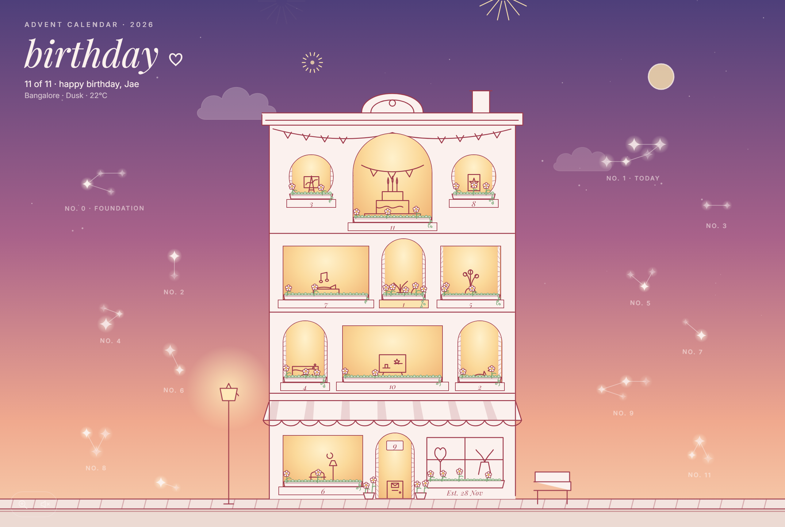</td>
</tr>
<tr>
<td><sub><b>At night</b> the sky turns dark, the stars come out, and a lamp glows in every window that has been worked in.</sub></td>
<td><sub><b>On the last day</b> every window lights up, a cake appears on the top floor, and fireworks go off over the roof.</sub></td>
</tr>
</table>

<table>
<tr>
<td width="62%"></td>
<td width="38%"></td>
</tr>
<tr>
<td><sub><b>Zoom mode</b> makes the windows and text much bigger, one floor at a time; the arrow keys ride between floors.</sub></td>
<td><sub><b>On phones</b> a brass elevator dial moves the camera between floors.</sub></td>
</tr>
</table>

## The doors

One door a day, about two hours of building each, each one something new to
learn.

| Door | Build | What it explores | |
|---|---|---|---|
| 0 | [The building](https://advent-birthday-hng9.vercel.app) | webhooks, realtime, server-side unlock rules | open |
| 1 | [The living garden](https://advent-birthday-hng9.vercel.app/door/1) | Supabase Realtime, seeded generative SVG | open |
| 2 | [Mochi, the coding pet](https://advent-birthday-hng9.vercel.app/door/2) | statecharts, A\* pathfinding, projectile physics | open |
| 3 | [Birthday records](https://advent-birthday-hng9.vercel.app/door/3) | seeded generative painting, Spotify iFrame API | open |
| 4 | [The commit pond](https://advent-birthday-hng9.vercel.app/door/4) | boids, spatial hashing, GPU water, WebGPU compute | open |
| 5 | [The infinite bloom](https://advent-birthday-hng9.vercel.app/door/5) | self-similarity, SDF shaders, Rust → WebAssembly | open |
| 6 | [The photo booth](https://advent-birthday-hng9.vercel.app/door/6) | GPU image pipeline, print-size canvas, rate limiting | open |
| 7 | [The firefly carousel](https://advent-birthday-hng9.vercel.app/door/7) | balanced k-means, 2-opt, three.js line art, Web Audio | open |
| 8 | [The holographic card](https://advent-birthday-hng9.vercel.app/door/8) | device orientation, CSS foil, Satori share images | open |
| 9 | [Mochi's rooftop run](https://advent-birthday-hng9.vercel.app/door/9) | fixed-timestep game loop, seeded daily courses, replays | open |
| 10 | [Birthday eve](https://advent-birthday-hng9.vercel.app/door/10) | a shared clock, reusing the building's drawing data | open |
| 11 | Blow out the candles | signal processing | shuttered |

## How a push travels

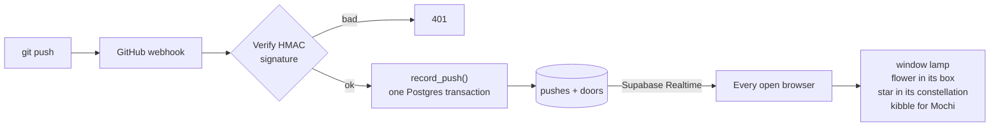

1. **GitHub** sends a signed `push` event to `/api/github/webhook`.
2. The route **verifies the HMAC-SHA256 signature** over the raw body, in
   constant time.
3. It sorts the changed files by kind and calls **`record_push()`**: one
   transaction that records the push (deduplicated on the delivery ID), lights
   today's window, and opens any door tagged `door:N` in a commit message.
4. **Supabase Realtime** streams the new row over a websocket, and every open
   page grows the flower and the star and drops kibble, in about a second.

## Engineering notes

- **Resilient deploys.** The webhook and queries notice a database that hasn't
  had the latest migration yet and fall back instead of failing, so code and
  schema can ship in either order.
- **Deterministic everywhere.** Flowers, stars, constellations and records are
  all seeded with integer-only hashing, so every device draws the same thing.
- **Tested logic, thin rendering.** Mochi's brain, her route planner, the jump
  maths and the record painter are pure modules with `node:test` tests; the
  React components just draw what they return.
- **Private by default.** "Make yours" only uses a month and day, keeps it in
  the URL, and saves nothing. The booth's photos never leave the browser.
- **Accessible.** Windows and Mochi are real buttons with spoken labels, there's
  a zoom mode and keyboard navigation, and all motion respects
  `prefers-reduced-motion`.
- **Home-made README animations.** The GIFs above are recorded by
  `scripts/animations.mjs`, which drives headless Chrome over the DevTools
  protocol and encodes frames with a small dependency-free GIF encoder
  (palette quantisation, changed-rectangle frames, LZW).

## Built with

| | |
|---|---|
| **Frontend** | Next.js 16 (App Router) · React 19 · TypeScript · Tailwind CSS 4 · Framer Motion · hand-drawn SVG · Canvas 2D |
| **Behaviour** | XState 5 statecharts · A\* pathfinding · projectile physics · boids with a spatial hash · balanced k-means and 2-opt · a fixed-timestep game loop with replays · seeded PRNG (mulberry32) |
| **GPU** | three.js line art · WebGL2 wave-equation water · signed-distance-field shaders · WebGPU compute and instanced rendering (WGSL) |
| **Rust** | a tiny Rust crate compiled to WebAssembly (no wasm-bindgen), raced against TypeScript |
| **Backend** | Next.js route handlers · Supabase (Postgres, Row Level Security, Realtime) |
| **Data** | GitHub push webhooks · Open-Meteo weather API · Spotify embed (iFrame API) · device orientation · Satori share images (`next/og`) |
| **Hosting** | Vercel (deploys on every push to `main`) |
| **Tooling** | pnpm workspaces · `node:test` · headless-Chrome screenshots and GIFs |

```
apps/web/                 the Next.js site
  app/page.tsx            the building (server: unlock rules, sky, pushes)
  app/door/[n]/           one page per door, sealed until its day
  app/api/github/webhook/ signed GitHub push → record_push()
  app/api/guestbook/      the booth's guestbook: checked, rate-limited notes
  components/building/    façade, windows, window boxes, constellations, elevator
  components/mochi/       Mochi's drawing, runtime loop, live statechart diagram
  components/records/     record disc, turntable, crate, Spotify player hook
  components/pond/        GPU water, the pond, looks, the WebGPU stress test
  components/bloom/       the infinite bloom: SDF renderer and page
  components/booth/       the photo booth: room, GPU darkroom, strip painter, guestbook
  components/firefly/     the 3D line-art carousel and the music box
  components/card/        the holo card, its painted window and engraved back
  components/run/         the rooftop run: canvas painter, game loop, sounds
  lib/mochi/              her statechart and world model (A*, jump arcs), with tests
  lib/records/            the seeded record painter and the song list, with tests
  lib/pond/               flocking, spatial hash and koi-from-pushes, with tests
  lib/bloom/              self-similarity maths and the tree walk, with tests
  lib/booth/              films, the 2 × 6 strip and guestbook rules, with tests
  lib/firefly/            the songs' moods, clustering and ring order, with tests
  lib/card/               star signs, birth flowers and the card's numbers, with tests
  lib/run/                the run's simulation, daily courses and replays, with tests
wasm/bloom/               the same tree walk in Rust (pnpm build:wasm)
  lib/                    unlock rules (IST), sky, constellations, file kinds
packages/garden-ui/       shared design tokens, motion presets, DoorFrame
scripts/                  README screenshots, animations and the GIF encoder
supabase/migrations/      schema, row-level security, seed, record_push()
```

## Run it yourself

The full guide covers running it locally with preview modes, then Supabase,
Vercel and the GitHub webhook: **[docs/SETUP.md](docs/SETUP.md)**.

```bash
pnpm install
cp apps/web/.env.example apps/web/.env.local   # set DEV_UNLOCK_ALL=true
pnpm dev                                       # http://localhost:3000/?preview=mixed
pnpm --filter web test                         # unit tests
pnpm build:wasm                                # rebuild door 5's Rust engine (needs Rust + wasm32 target)
pnpm screenshots && pnpm animations            # README images, with the dev server running
```

---

<div align="center">

A new door opens every day until the last one. Come back tomorrow.

<sub>Made by <a href="https://github.com/iivanhaj">@iivanhaj</a> ·
<a href="https://advent-birthday-hng9.vercel.app">advent-birthday-hng9.vercel.app</a></sub>

</div>
