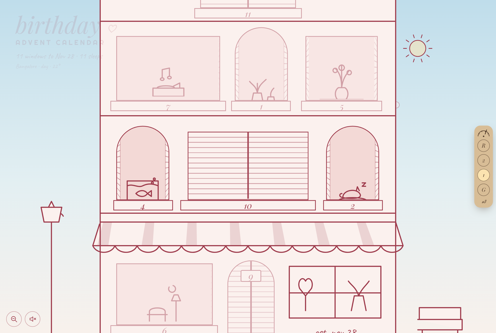

<div align="center">

# birthday ♡ advent calendar

### Eleven days, eleven tiny builds, and one hand-drawn building that grows while I code.

[**✨ Open the building**](https://advent-birthday-hng9.vercel.app)
&nbsp;·&nbsp;
[**🎵 Paint your birthday records**](https://advent-birthday-hng9.vercel.app/door/3)
&nbsp;·&nbsp;
[**🐈 Meet Mochi**](https://advent-birthday-hng9.vercel.app/door/2)

<br/>


[](https://advent-birthday-hng9.vercel.app)


</div>

[](https://advent-birthday-hng9.vercel.app)

## The idea

My birthday is on **November 28**. This year, instead of just counting down,
I'm building my way there: **one small, self-contained project a day**, each one
something I've wanted to learn, each one living behind a window of a little
hand-drawn building.

The building isn't a static page. It's wired to my GitHub: **every `git push`
I make changes it, live**, for whoever has it open. A window lights up, a flower
grows in its window box, a star joins that day's constellation, and a piece of
kibble drops for Mochi, the cat who lives on the site.

### The rules I set myself

- **One door a day**, about two hours each. A door opens at midnight (India
  time) and stays shuttered until then, enforced by the server, so changing
  your clock doesn't help.
- **Every door teaches me something new.** Statecharts, pathfinding,
  generative art, realtime, and later WebGPU, Rust → WASM, cryptography.
- **One pen line.** Everything is drawn in the same 1.5 px rose ink on paper,
  so eleven very different builds still feel like one building.
- **Ship it live, in small commits.** The building *is* the commit log.

### Try it

> 🪟 **Peek in a window**: hover to open the shutters, click to fly inside.
>
> 🐈 **Find Mochi**: bring your cursor close and she'll chase it; click her and she purrs.
>
> 🎵 **[Paint your birthday records](https://advent-birthday-hng9.vercel.app/door/3)**: enter your birthday and every song gets a record painted from it. Download yours, or send the link.
>
> 🌙 **Come back at night**: Bangalore's real sky, lamps in the windows I've worked in, and a new door every midnight until Nov 28.

---

## Door 0 · The building

A fine-line building with eleven windows, one per day, on a street under
Bangalore's actual sky.

- **The sky is real.** Dawn, day, dusk, night and rain come from the Open-Meteo
  API (cached for 10 minutes, so every visitor shares one request). At night,
  lamps glow in every window I've worked in.
- **The server owns the clock.** Which doors are open is decided on the server
  in India time; a sealed door's page never sends its content to the browser.
- **Windows are real buttons.** Shutters swing open with a CSS 3D transform,
  and an open window's camera **flies through the glass** into that door's
  page.
- **On phones, an elevator.** The camera rides between floors, with a brass
  dial, swipes and ↑/↓ keys. There's a zoom mode for anyone who finds the
  building small.

<details>
<summary><b>The interesting bit: a webhook you can't double-count</b></summary>

GitHub retries webhook deliveries, so a push must never be recorded twice.
The delivery ID is a unique key, and the whole "record the push, light the
window, ship tagged doors" step is one Postgres function, so it's atomic and
idempotent:

```sql
insert into pushes (delivery_id, repo, sha, message, pushed_at, ist_date, files)
values (p_delivery_id, p_repo, p_sha, p_message, p_pushed_at, p_ist_date, p_files)
on conflict (delivery_id) do nothing;

if not found then
  return jsonb_build_object('duplicate', true);   -- a retry: nothing happens
end if;
```

Before that, the route verifies GitHub's HMAC-SHA256 signature over the raw
body with a constant-time comparison, so forged pushes get a `401`.
</details>

## Door 1 · The living garden


**[▶ Visit the greenhouse](https://advent-birthday-hng9.vercel.app/door/1)**: hover a flower to see the commit that grew it.

A glass greenhouse under the night sky. Inside, one pot per door: **every push
grows a stem** in its day's pot, so busy days become bushy plants. Outside, the
same push is a star in that day's constellation.

- **Flowers are tinted by what the push touched.** The webhook sorts every
  changed file (TypeScript, CSS, SQL, Markdown…) and the petals split between
  those colours in proportion.
- **Five species** (cosmos, tulip, bellflower, lavender, rose), picked by the
  commit's SHA, so a commit always grows the same flower.
- **Live:** Supabase Realtime streams the new row, and the stem grows in about
  a second on every open screen.

<details>
<summary><b>The interesting bit: a hydration bug from <code>Math.cos</code></b></summary>

Every flower and star is seeded from the commit SHA, so server and browser
should draw identical SVG. They didn't: Node and browsers can disagree on the
last digit of trig results, which was enough to break React hydration. The fix
was integer-only hashing (`Math.imul`), rounded coordinates, and precomputed
direction tables instead of `Math.cos` in anything that's server-rendered.
</details>

## Door 2 · Mochi, the coding pet


**[▶ Meet Mochi](https://advent-birthday-hng9.vercel.app/door/2)**: pet her, drop her a treat, or press "Show her route".

Mochi is a fine-line cat who lives on **every page** of the site. She wanders,
grooms, naps, chases your cursor, and climbs the building: the planters, the
awning, the cornice and the bench are all ledges she can jump between. Every
push drops kibble on every open screen, and she works out how to get to it.

- **A statechart brain** (XState): idle, wander, sit, groom, chase, watch,
  hungry, toFood, eating, purr, asleep. It only decides *what* she wants.
- **The page is her level.** Elements marked `data-mochi-platform` become
  one-way ledges, re-measured every frame while the camera zooms and scrolls.
  **A\*** over (ledge, x) states finds the cheapest mix of walks and jumps.
- **Real jumps.** Each one is a projectile arc through an apex above the higher
  ledge: y = y₀ + v₀t + ½gt².
- **Hunger from the push log**, not a timer: it's the time since my last push,
  so every device agrees on how hungry she is.

<details>
<summary><b>The interesting bit: brain and body, kept apart</b></summary>

The statechart never touches the DOM. It wants things; the animation loop
plans a route, walks and jumps, and reports back with events:

```ts
chase:  { on: { ARRIVED: "watch", CURSOR_LEFT: "idle" } },
toFood: { on: { ARRIVED: "eating", FOOD_GONE: "idle" } },
eating: { after: { eat: { target: "idle", actions: [emit({ type: "ate" })] } } },
```

Because delays and randomness are injectable (`machine.provide(...)`), every
behaviour (napping when bored, food interrupting play, not being interrupted
mid-bite) has a plain `node:test` unit test, and so do the A\* planner and the
jump maths. Her page draws the statechart **from the machine definition
itself**, so the diagram can't drift from the code.
</details>

## Door 3 · Birthday records


**[▶ Paint your birthday records](https://advent-birthday-hng9.vercel.app/door/3)**: enter your birthday, put a record on, download it.

A crate of eight songs I love, and every song gets **its own record, painted by
my birthday**. Pull one out and it drops onto the turntable, spins up, and
plays through Spotify while the tonearm rides the record with the song's
progress. Enter your birthday and the whole crate repaints for you.

- **Birthday × song.** Each record's seed mixes the birthday (month and day
  only, never the year) with the song's Spotify ID: every song looks
  different, and the same birthday always paints the same crate.
- **Three themes over one seed:** *Dreamy* (swirls, dotted rings, glitter),
  *Meadow* (vines and inked flowers), *Painted vinyl* (black vinyl, painted
  band, printed label).
- **A turntable with weight.** The platter eases up to 33⅓ rpm and coasts
  down, and the sheen stays still while the record turns under it, which is
  what makes it look like it's spinning.
- **Shareable and printable.** Birthday and theme live in the URL, and any
  record downloads as a 3000 px PNG.

<details>
<summary><b>The interesting bit: plan, then paint</b></summary>

Painting is split in two. `plan()` is pure: seed in, a list of brush
instructions out (blobs, swirls, dotted rings, flowers), all in "record units"
where the disc has radius 1. `render()` is a thin loop that paints a plan at
any size.

```ts
export const recordSeed = (birthday: string, trackId: string) =>
  hashString(`${birthday}:${trackId}`);       // "11-28:113xf7t4…" → 0xfca6829f

plan("11-28", track, "dreamy")   // → { seed, hue, brushes: [...] }, same on every device
```

That split makes the art testable without a canvas: determinism, every mark
on the disc, and flowers that never crowd each other (Poisson-disc sampling).
The watercolour look is dozens of nearly transparent layers of a recursively
deformed polygon, not one soft blob.
</details>

---

<table>
<tr>
<td width="50%"></td>
<td width="50%"></td>
</tr>
<tr>
<td align="center"><sub><b>Night:</b> lamps glow in every window I've worked in</sub></td>
<td align="center"><sub><b>Nov 28:</b> every window lights up, the cake appears, fireworks</sub></td>
</tr>
</table>

<table>
<tr>
<td width="62%"></td>
<td width="38%"></td>
</tr>
<tr>
<td align="center"><sub><b>🔍 Zoom</b> for bigger windows and text (↑/↓ to change floors)</sub></td>
<td align="center"><sub><b>Phones:</b> a brass elevator rides between floors</sub></td>
</tr>
</table>

## The eleven doors

A new door opens every midnight, India time.

| # | Date | Build | What I'm learning | |
|---|---|---|---|---|
| 0 | Tue 17 | [The building](https://advent-birthday-hng9.vercel.app) | webhooks, realtime, server-side unlock rules | ✅ |
| 1 | Wed 18 | [The living garden](https://advent-birthday-hng9.vercel.app/door/1) | Supabase Realtime, seeded generative SVG | ✅ |
| 2 | Thu 19 | [Mochi, the coding pet](https://advent-birthday-hng9.vercel.app/door/2) | statecharts, A* pathfinding, projectile physics | ✅ |
| 3 | Fri 20 | [Birthday records](https://advent-birthday-hng9.vercel.app/door/3) | seeded generative painting, Spotify iFrame API | ✅ |
| 4 | Sat 21 | GPU koi pond | spatial hashing, WebGPU | 🔒 |
| 5 | Sun 22 | Recursive flowers | L-systems, Rust → WASM | 🔒 |
| 6 | Mon 23 | Cozy room, real sky | caching, edge functions | 🔒 |
| 7 | Tue 24 | Firefly music | embeddings, clustering | 🔒 |
| 8 | Wed 25 | Holographic card | sensor APIs, OG images | 🔒 |
| 9 | Thu 26 | Time-locked letter | applied cryptography | 🔒 |
| 10 | Fri 27 | Jae: The Game | ECS, deterministic replays | 🔒 |
| 11 | Sat 28 🎂 | Blow out the candles | signal processing | 🔒 |

## How a push travels


1. **GitHub** sends a signed `push` event to `/api/github/webhook`.
2. The route **verifies the HMAC-SHA256 signature** over the raw body, in
   constant time.
3. It sorts the changed files by tech stack and calls **`record_push()`**: one
   transaction that records the push (deduplicated on the delivery ID), lights
   today's window, and ships any door tagged `door:N` in a commit message.
4. **Supabase Realtime** streams the new row over a websocket, and every open
   page grows the flower and the star and drops kibble, in about a second.

## Engineering notes

- **Resilient deploys.** The webhook and queries detect a database that hasn't
  had the latest migration yet and fall back instead of failing, so code and
  schema can ship in either order.
- **Determinism everywhere.** Flowers, stars, constellations and records are
  all seeded, with integer-only hashing, so every device draws the same thing.
- **Unit-tested logic, thin rendering.** Mochi's brain, her route planner, the
  jump maths and the record painter are pure modules with `node:test` tests;
  the React components just draw what they return.
- **Privacy by default.** "Make yours" uses only a month and day, keeps it in
  the URL, and saves nothing.
- **Accessibility.** Windows and Mochi are real buttons with spoken labels;
  there's a zoom mode and keyboard navigation; all motion respects
  `prefers-reduced-motion`.

## Built with

| | |
|---|---|
| **Frontend** | Next.js 16 (App Router) · React 19 · TypeScript · Tailwind CSS 4 · Framer Motion · hand-drawn SVG · Canvas 2D |
| **Behaviour** | XState 5 statecharts · A\* pathfinding · projectile physics · seeded PRNG (mulberry32) |
| **Backend** | Next.js route handlers · Supabase (Postgres, Row Level Security, Realtime) |
| **Data** | GitHub push webhooks · Open-Meteo weather API · Spotify embed (iFrame API) |
| **Hosting** | Vercel (auto-deploys on every push to `main`) |
| **Tooling** | pnpm workspaces · `node:test` · headless-Chrome screenshot script |

```
apps/web/                 the Next.js site
  app/page.tsx            the building (server: unlock rules, sky, pushes)
  app/door/[n]/           one page per door, sealed until its date
  app/api/github/webhook/ signed GitHub push → record_push()
  components/building/    façade, windows, window boxes, constellations, elevator
  components/mochi/       Mochi's drawing, runtime loop, live statechart diagram
  components/records/     record disc, turntable, crate, Spotify player hook
  lib/mochi/              her statechart and world model (A*, jump arcs), with tests
  lib/records/            the seeded record painter and the song list, with tests
  lib/                    unlock rules (IST), sky, constellations, file kinds
packages/garden-ui/       shared design tokens, motion presets, DoorFrame
supabase/migrations/      schema, row-level security, seed, record_push()
```

## Run it yourself

The full guide covers running it locally with preview modes, then Supabase,
Vercel and the GitHub webhook: **[docs/SETUP.md](docs/SETUP.md)**.

```bash
pnpm install
cp apps/web/.env.example apps/web/.env.local   # set DEV_UNLOCK_ALL=true
pnpm dev                                       # http://localhost:3000/?preview=mixed
pnpm --filter web test                         # unit tests
```

---

<div align="center">

**Follow along:** a new door opens every midnight until Nov 28.
If you paint a crate you love, send someone the link, and if this made you
smile, a ⭐ makes my day.

<sub>Made by <a href="https://github.com/iivanhaj">@iivanhaj</a> ·
<a href="https://advent-birthday-hng9.vercel.app">advent-birthday-hng9.vercel.app</a></sub>

</div>
